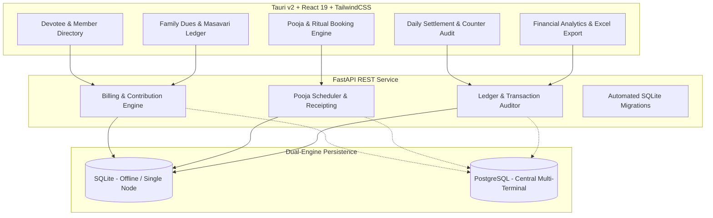

# Temple-ERP: Enterprise Community & Institution Management Suite

[](https://fastapi.tiangolo.com/)
[](https://react.dev/)
[](https://tauri.app/)
[](https://www.typescriptlang.org/)
[](https://tailwindcss.com/)
[](https://www.python.org/)
[](LICENSE)

An offline-first, enterprise-grade Desktop and Web ERP suite engineered for temples, charitable trusts, and community organizations. Built on a modular architecture combining a **FastAPI** REST backend with a lightweight, cross-platform **Tauri v2 + React 19** desktop runtime.

---

## Key Modules & Features



### 1. Devotee & Membership Directory
- Comprehensive registry tracking family trees, head of household, and member details.
- Astrological nakshatra / birth-star indexing for ceremonial notifications and ritual bookings.
- Unique membership IDs with audit logging for active, inactive, and deceased status.

### 2. Pooja & Ritual Management
- Interactive booking calendar for daily rituals, special ceremonies, and advance prasadam orders.
- Automated rate lookup and token/receipt generation with sequential receipt numbering.
- Real-time priest and altar allocation tracking.

### 3. Masavari & Family Contribution Ledger
- Automated monthly recurring dues calculation engine (*Masavari*) with auto-accumulation.
- Specialized funds tracking including Death Relief Fund (DRF) and festival levy distributions.
- Multi-tier contribution categories with historical arrears tracking and family ledger cards.

### 4. Counter Settlement & Audit Control
- End-of-shift reconciliation for counter operators (cash drawer counts, UPI / card receipts).
- Settlement difference tracking to detect discrepancies before book closing.
- Immutable ledger entry creation with payment mode audit trails (`CASH`, `UPI`, `CARD`, `BANK`).

### 5. Financial Analytics & Excel Export
- Dynamic KPI dashboards built with Recharts showing daily collections, arrears distribution, and pooja revenue trends.
- Single-click Excel export (`.xlsx`) for monthly statements, tax audits, and committee meetings.

---

## Tech Stack

| Layer | Technologies |
|---|---|
| **Backend Framework** | [FastAPI](https://fastapi.tiangolo.com/), [Uvicorn](https://www.uvicorn.org/) |
| **ORM & Database** | [SQLAlchemy 2.0](https://www.sqlalchemy.org/), SQLite (Local Dev / Offline Desktop), PostgreSQL (Server) |
| **Data Validation** | [Pydantic v2](https://docs.pydantic.dev/), [Pydantic Settings](https://docs.pydantic.dev/latest/concepts/pydantic_settings/) |
| **Desktop Runtime** | [Tauri v2](https://tauri.app/) (Rust-powered native desktop shell) |
| **Frontend Framework**| [React 19](https://react.dev/), [TypeScript](https://www.typescriptlang.org/), [Vite](https://vite.dev/) |
| **Styling & UI** | [TailwindCSS](https://tailwindcss.com/), [Radix UI](https://www.radix-ui.com/), [Lucide React](https://lucide.dev/), [Framer Motion](https://www.framer.com/motion/) |
| **Tables & Charts** | [TanStack Table v8](https://tanstack.com/table/v8), [Recharts](https://recharts.org/) |
| **Testing** | [Pytest](https://docs.pytest.org/), [HTTPX](https://www.python-httpx.org/) |

---

## Repository Structure

```text
Temple-ERP/
├── backend/
│   ├── api/routes.py            # API endpoint router definitions
│   ├── core/                    # App configuration, security, database engines
│   ├── models/                  # SQLAlchemy ORM models (Ledger, Families, Dues)
│   ├── schemas/                 # Pydantic request/response validation schemas
│   ├── services/                # Business logic (Billing, settlements, calculations)
│   ├── tests/                   # 8 comprehensive pytest suites for ledger & dues
│   ├── main.py                  # FastAPI application entrypoint & startup migrations
│   ├── requirements.txt         # Python package dependencies
│   └── .env.example             # Backend configuration template
├── frontend/
│   ├── src/
│   │   ├── components/          # Reusable UI primitives (dialogs, tables, cards)
│   │   ├── pages/               # Dashboard, Pooja, Devotee, Settlement, Dues pages
│   │   ├── lib/ & utils/        # API client helpers & currency formatters
│   │   ├── App.tsx & main.tsx   # React router and application mount
│   │   └── index.css            # Tailwind directives and custom theme
│   ├── src-tauri/               # Tauri v2 Rust project for native executable compilation
│   ├── package.json             # NPM package manifest
│   └── vite.config.ts           # Vite bundler configuration
├── .gitignore                   # Ignore rules for virtualenvs, node_modules, and binaries
└── README.md                    # Project documentation
```

---

## Getting Started

### Prerequisites
- **Python**: 3.11+
- **Node.js**: 18+ (Node 20 recommended)
- **Rust & Cargo**: (Optional, required only for compiling native Tauri desktop binaries)

---

### Backend Setup

1. **Navigate to the backend directory**:
   ```bash
   cd backend
   ```

2. **Create and activate a virtual environment**:
   ```bash
   # Windows
   python -m venv venv
   .\venv\Scripts\activate

   # Linux / macOS
   python3 -m venv venv
   source venv/bin/activate
   ```

3. **Install dependencies**:
   ```bash
   pip install -r requirements.txt
   ```

4. **Configure environment variables**:
   ```bash
   # Copy the example config
   cp .env.example .env
   ```

5. **Start the FastAPI backend server**:
   ```bash
   uvicorn main:app --reload --port 8000
   ```
   Interactive Swagger documentation will be available at: `http://localhost:8000/docs`

6. **Run Backend Test Suite**:
   ```bash
   pytest tests/ -v
   ```

---

### Frontend Setup (Web & Desktop)

1. **Navigate to the frontend directory**:
   ```bash
   cd frontend
   ```

2. **Install frontend dependencies**:
   ```bash
   npm install
   ```

3. **Run Web Development Server**:
   ```bash
   npm run dev
   ```
   The web application opens at: `http://localhost:1420` (or `http://localhost:5173`)

4. **Launch Native Desktop App (Tauri)**:
   ```bash
   npm run desktop
   ```

5. **Build Desktop Installer / Executable**:
   ```bash
   npm run desktop:build
   ```
   The compiled `.msi` / `.exe` installer will be located in `src-tauri/target/release/bundle/`.

---

## Architectural Principles

1. **Offline-Resilient Architecture**: Defaults to SQLite for local standalone terminals without network dependencies, with immediate seamless fallback for multi-counter networked PostgreSQL setups.
2. **Double-Entry Financial Integrity**: Contribution calculations, dues accumulation, and settlements are calculated sequentially with atomic database transactions to ensure ledger balance.
3. **Strict Validation**: All financial payloads and devotee entries are enforced via Pydantic schemas with type assertions before database write.
4. **Comprehensive Test Coverage**: Mission-critical calculation routines (Masavari accumulation, festival charge allocations, payment reconciliations) are verified by unit tests under `backend/tests/`.

---

## License

This project is licensed under the [MIT License](LICENSE).
